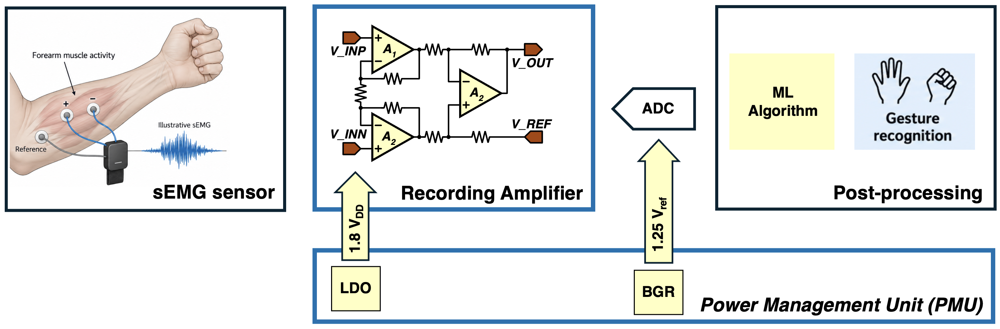

# Analogue Integrated Circuit Design Coursework

Design, simulate and evaluate two analogue subsystems in GPDK180: a power management unit and a surface electromyography (sEMG) recording amplifier. Use transistor-level circuits in Cadence Virtuoso, support design decisions with hand calculations, and verify performance through reproducible simulations.

This guide follows the technical requirements of the 2026 coursework brief. Institution-specific administration and policies have been omitted. The specification tables in the chapters below replace the earlier exploratory targets in this repository.

## Chapters

| Chapter | Design task | Main targets | Deliverables |
| --- | --- | --- | --- |
| [Task 1: Power Management Unit](docs/task-1-pmu.md) | Operational amplifiers, bandgap reference (BGR), low-dropout regulator (LDO), and integration | 1.8 V regulated output up to 20 mA; 1.25 V reference | Report section, maximum 8 pages; complete Cadence library in ZIP or TAR format |
| [Task 2: Surface EMG Recording Amplifier](docs/task-2-semg.md) | Low-noise differential acquisition for forearm gesture recognition | 40 dB gain; 10 Hz to 1 kHz nominal passband; current ≤ 20 µA | Report section, maximum 8 pages; no design-file submission required |

## Task 1: Power Management Unit

Build a BGR and LDO that produce a stable reference and regulated supply from a 2.0-2.5 V input. Design the operational amplifiers for their actual feedback configurations, loads and startup conditions. Verify the complete PMU across supply, load, temperature and process variations.

[Read Chapter 1: specifications, architecture, verification, interface and reporting](docs/task-1-pmu.md).

## Task 2: Surface EMG Recording Amplifier

Design one recording channel for wet Ag/AgCl electrodes. Amplify differential muscle signals while controlling noise, electrode-offset sensitivity, power consumption and interference. The ADC and gesture-recognition processing provide system context; their design is outside this task.

*System context. The recording amplifier is the focus of Task 2. The drawn instrumentation amplifier is an example; alternative architectures are permitted. Signal flow is from electrodes to amplifier, ADC and digital processing.*

[Read Chapter 2: specifications, architecture options, verification and reporting](docs/task-2-semg.md).

## Working approach and reporting

- Work in pairs, with clearly identified ownership and shared design reviews. Suggested responsibilities appear in each chapter.
- Start with analytical sizing and bias calculations. Adapt published designs to permitted GPDK180 devices and explain your choices.
- Provide schematics, operating points, labelled simulation plots and a final target-versus-result table. Record conditions so that results can be reproduced.
- Discuss limitations and unsuccessful targets: sound engineering methodology and critical evaluation remain important when a specification is not achieved.
- Combine both task reports into a document of at most 16 pages, using 11-point Arial, single line spacing and 2 cm margins. Identify each contributor's calculations, circuits, simulations and design decisions.

No layout or fabrication is required by this guide.

## Reading and source notes

Supporting papers are in [resources](resources/), with task-specific reading linked in each chapter. Existing figures are in [assets](assets/).

The rewrite resolves the source brief's inconsistencies as follows:

- Task 2 uses the numerical table's **10 ± 2 Hz** lower cutoff and **1 ± 0.2 kHz** upper cutoff. The source introduction's 20-1000 Hz description is not used as a competing requirement.
- Task 2 is **report only**, following its explicit deliverables statement. Packaging and automated-interface requirements apply to Task 1 only.
- The title of Analog Devices tutorial MT-063 is corrected to *Basic Three Op Amp In-Amp Configuration*.
- Example figures are conceptual starting points. Numerical requirements are defined by the chapter tables; ambiguous figure annotations do not add extra specifications.
