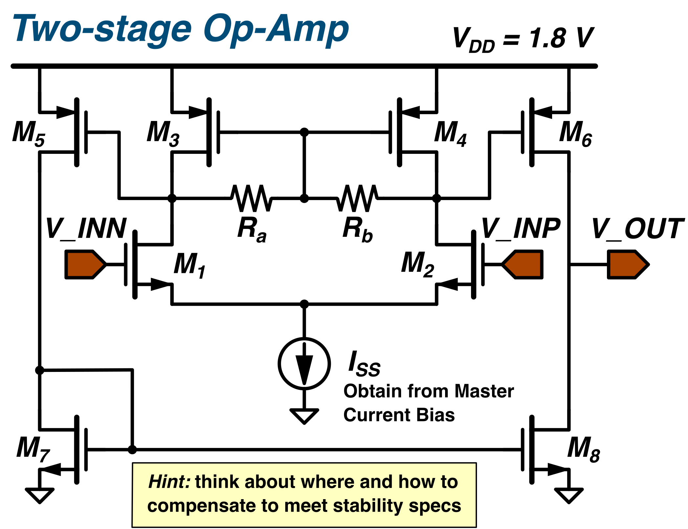
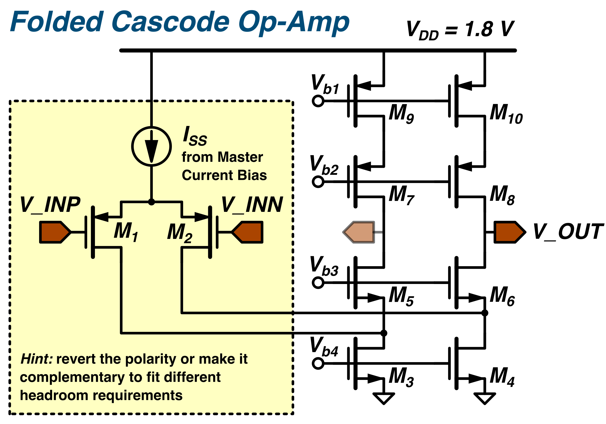
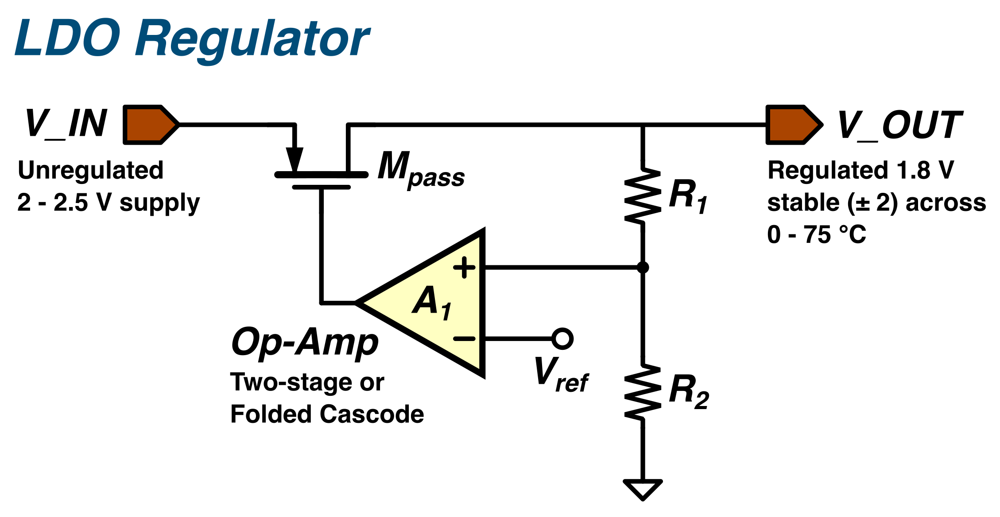
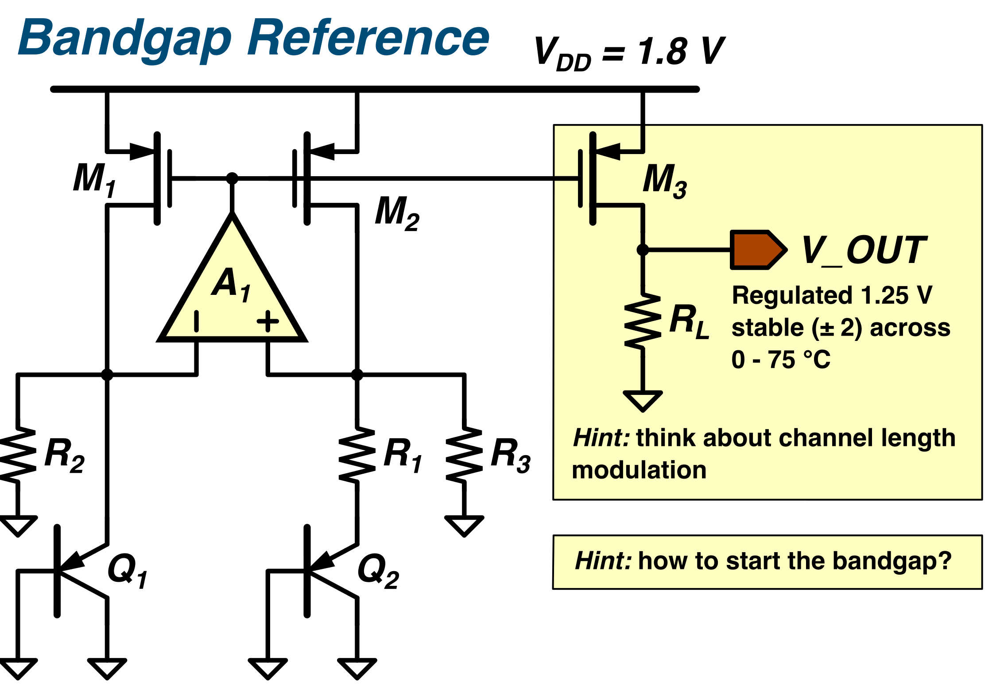

# Analogue Integrated Circuit Coursework

## Aim and approach

The basic requirements should be achievable for most students who have studied the course. More ambitious students can earn additional marks through advanced design features.

Use the circuit structures, design methods and specifications in Razavi’s article as a starting point. Students must adapt the designs to the available PDK and determine device sizes through their own design and simulation work. Copying the article’s dimensions is insufficient: for example, a 140 nm channel length is not available in a PDK with a minimum channel length of 180 nm.

A 1.8 V supply is proposed. Ambitious students are encouraged to explore operation at 1.2 V to reduce power consumption, while recognising the greater design challenge in device operation region.

## 0. TODO: 

 - [ ] op-amp design specs
 - [ ] circuit diagram drawing
 - [ ] descriptions of the extra tasks, alongside with references

## Op-amp circuit options

The following diagrams show two starting topologies for the op-amp design. Compare their gain, stability, biasing and voltage-headroom requirements before choosing an implementation. The op-amp specifications remain to be confirmed in the instructor checklist above.

### Two-stage op-amp

*Figure 1. Two-stage op-amp starting circuit at 1.8 V. Determine the device sizes and bias currents, and investigate where compensation is needed to meet the stability requirements.* [View SVG](assets/TASK_1_two_stage_opamp_circuit.svg)

### Folded-cascode op-amp

*Figure 2. Folded-cascode op-amp starting circuit at 1.8 V. Check the bias voltages and saturation margins throughout the signal path; consider the complementary topology if the required input common-mode range calls for it.* [View SVG](assets/TASK_1_folded_cascode_opamp_circuit.svg)

## 1. Low-dropout regulator (LDO)

The error amplifier drives the PMOS pass transistor so that the feedback-divider voltage follows the reference. Either op-amp topology above can be investigated as the error amplifier; verify stability with the pass transistor and load included.

*Figure 3. LDO starting architecture. The diagram shows the regulator feedback path; include the load and any chosen compensation or output capacitance in the simulation testbench.* [View SVG](assets/TASK_2_LDO_circuit.svg)

### Proposed specifications

| Parameter | Proposed specification |
| --- | --- |
| Input voltage | 2.5 V |
| Output voltage | 1.8 V |
| Maximum output current | 5 mA |
| PSRR | 40 dB at 1 MHz |
| Output noise spectral density | < 100 nV/√Hz at 1 MHz |

## 2. Bandgap reference

The circuit below is the starting topology for Task 3. The op-amp forces the two sensing nodes toward the same voltage, while the unequal bipolar-junction areas and resistor network generate the PTAT and CTAT contributions used to obtain a temperature-stable reference. Students should size the circuit, add a reliable startup network and assess the effect of finite output resistance.

*Figure 4. Task 3 bandgap-reference starting circuit at 1.8 V. The startup circuit is intentionally omitted and must be designed and verified by the student.* [View SVG](assets/TASK_3_bandgap_reference_circuit.svg)

### Proposed specifications

| Parameter | Proposed specification |
| --- | --- |
| Supply voltage | 1.8 V |
| Output voltage | 1.25 V |
| Output voltage variation | < 5 mV over 0–100 °C |
| PSRR | 40 dB |
| Power consumption | < 1 mW |

## 3. Recording amplifier

### Application scenario

**Revised application: surface electromyography (sEMG) for a forearm gesture-recognition or muscle-activation sensor using wet Ag/AgCl electrodes.** Students design one differential recording channel; a complete wearable would combine several channels with an ADC and digital processing. A published hand-motion sensor uses a 20–500 Hz signal band [1]. The coursework adopts this band for voluntary muscle contractions; it is not intended to cover every EMG application.

The system context is: electrodes → AC-coupled recording amplifier and band limiting → ADC → gesture processing. The bandgap supplies the LDO reference, and the LDO supplies the recording amplifier. The ADC and classifier are context only. The reference and LDO error amplifier need a supply/startup arrangement that does not depend on an already-regulated output.

The table below retains the README's 1.8 V recording-amplifier supply. The earlier 2.0 V, 100 µA standalone op-amp exercise is a separate operating point: recheck the reused op-amp at 1.8 V. If 2.0 V is selected for the complete system instead, revise the LDO output consistently. The 100 µA channel budget below corresponds to 180 µW at 1.8 V or 200 µW at 2.0 V.

### Basic specifications

Bold text marks a changed or newly defined requirement. These are proposed teaching targets, not specifications copied from one paper or demonstrated in GPDK180.

| Parameter | Revised basic specification | Modification and purpose |
| --- | --- | --- |
| Supply voltage | 1.8 V | Retained from this README; see the 2.0 V exercise distinction above. |
| Channel configuration | Differential input; single-ended output acceptable | Retained; fully differential output is optional because it adds common-mode feedback design. |
| Voltage gain | 40 dB, gain error < 1 dB **at 100 Hz** | Gain retained; test frequency defined. |
| Lower −3 dB cutoff | **20 Hz target; acceptable range 10–30 Hz** | New: rejects DC and attenuates low-frequency movement artifacts. |
| Upper −3 dB cutoff | **500 Hz target; acceptable range 400–600 Hz** | Replaces 10 kHz with the selected sEMG band [1]. Measure both cutoffs relative to peak passband gain. |
| Input-referred noise | < 5 µV RMS **integrated over 20–500 Hz** | Noise limit retained; integration band now explicit. Include all amplifier, bias and feedback-device noise. |
| Linearity | THD < 0.5% **at 100 Hz, 2 mV peak-to-peak differential input** | Limit retained; stimulus defined. Expected output is about 200 mV peak-to-peak. |
| Differential electrode DC offset | **Tolerate −50 mV to +50 mV after settling without saturation; retain the gain and THD limits above** | Replaces ambiguous “input offset < 400 mV”. This is external electrode offset, not the OTA's own input offset; the ±50 mV benchmark is supported by [3]. |
| CMRR | > 60 dB **at both 50 Hz and 60 Hz in nominal matched simulation** | Basic limit retained for accessibility; **80 dB is the preferred extension target**. Report degradation with electrode impedance imbalance. |
| PSRR | > 40 dB **at 50 Hz, 60 Hz and 100 Hz** | Limit retained; frequencies defined. Also plot 10 Hz–100 kHz. |
| Input impedance | **Magnitude ≥ 10 MΩ per input over 20–500 Hz** | New: reduces loading of the electrode source. Include the input coupling network in this measurement. |
| Channel current | **≤ 100 µA total quiescent current, including local bias and common-mode circuitry** | New channel budget, deliberately generous for the course. Excludes the separately assessed LDO and bandgap. |
| Stability and load | **Phase margin ≥ 60°** for load capacitances of 1–5 pF | Converts the existing reporting requirement into a nominal design target; also check transient settling. |
| Area | **Report total capacitance and estimated device/passive area** | No layout or fabricated-area requirement. |

Use nominal process, 27 °C and a noiseless supply/source for baseline gain, bandwidth, noise and THD assessment. Set input common mode and output quiescent level near VDD/2, and apply electrode DC offset differentially around that common mode. Characterise supply ±5%, 0–60 °C and available process corners; explain failures rather than requiring every basic limit at every corner. Supply variation must remain within the selected device model's allowed range.

For noise, report the input-referred noise spectrum and integrate its squared density from 20 to 500 Hz using the frequency-dependent signal gain. Keep electrode-source noise separate from the amplifier-only specification. Test DC offsets at −50, 0 and +50 mV with the 100 Hz signal superimposed after settling. Report recovery from a DC-offset step separately. Measure CMRR and PSRR from differential signal gain divided by common-mode-to-output and supply-to-output gain, respectively.

For a simple electrode-imbalance experiment, repeat CMRR with 10 kΩ in each input lead, then 10 kΩ and 20 kΩ. These are teaching test impedances, not a complete electrode model. A 60 dB CMRR converts 100 mV RMS common-mode interference to 100 µV RMS input-equivalent interference; at 80 dB it becomes 10 µV RMS. Thus the basic pass criterion alone does not establish robust wearable performance under strong mains interference. Band limiting also does not remove 50/60 Hz interference inside the sEMG band.

### Suggested implementation and evidence

Use a continuous-time, AC-coupled capacitive-feedback amplifier around a single-stage OTA, with a DC feedback path and explicit upper-band limiting. A capacitor ratio near 100 provides a starting point for 40 dB gain; finite OTA gain and passband roll-off must be included in the actual design. Do not confuse the 500 Hz closed-loop signal bandwidth with the OTA's unity-gain bandwidth. Permit ideal passive components or an external RC band-limiting network for the basic exercise, with their values and noise accounted for. An integrated pseudo-resistor is an extension if its nonlinearity or corner variation would dominate the five-week task.

The following papers support the application and design choices. The numerical pass limits, tolerances and grading scope above are instructor recommendations; none of these papers proves that an untested GPDK180 implementation meets them.

| Reference | Evidence relevant to this coursework | How students should use it |
| --- | --- | --- |
| [1] *Hand Motion Classification Using a Multi-Channel Surface Electromyography Sensor*, Sensors, 2012. [Paper](https://www.mdpi.com/1424-8220/12/2/1130) | A forearm surface-EMG hand-motion system uses 20 Hz high-pass and 500 Hz low-pass filtering. | Direct application evidence for the selected signal band. This additional application paper supplies the band choice; the IC papers below support circuit techniques. |
| [2] R. F. Yazicioglu, P. Merken, R. Puers and C. Van Hoof, *A 60 µW 60 nV/√Hz Readout Front-End for Portable Biopotential Acquisition Systems*, **ISSCC 2006**, paper 2.6. [DOI](https://doi.org/10.1109/ISSCC.2006.1696039) · [Paper](https://picture.iczhiku.com/resource/ieee/WYKsAeIRGQFGDcxm.pdf) | Configurable EEG/ECG/EMG readout using AC coupling, chopping and adjustable gain; motivates low noise, high CMRR and electrode-offset rejection. | Architecture reading. Chopping and its spike filter are extension topics. |
| [3] R. F. Yazicioglu et al., same title, **JSSC 42(5), 1100–1110, 2007**. [DOI](https://doi.org/10.1109/JSSC.2007.894804) · [Author manuscript](https://lirias.kuleuven.be/bitstream/123456789/70920/1/Puers_4_Full_Paper.pdf) | The AC-coupled chopped instrumentation amplifier rejects ±50 mV differential electrode offset; reports 57 nV/√Hz noise density and 120 dB CMRR, with a 60 µW complete front end at 3 V. | Detailed explanation of [2], not independent evidence. Supports the offset test and optional noise/CMRR improvements; its results are not baseline student requirements. |
| [4] J.-S. Bang, H. Jeon, M. Je and G.-H. Cho, *6.5 µW 92.3dB-DR Biopotential-Recording Front-End with 360mVpp Linear Input Range*, **VLSI Circuits 2018**, pp. 239–240. [DOI](https://doi.org/10.1109/VLSIC.2018.8502264) · [Authors' institutional record](https://pure.kaist.ac.kr/en/publications/65%CE%BCw-923db-dr-biopotential-recording-front-end-with-360mvsubppsub/) | A 0.18 µm direct-to-digital biopotential front end demonstrates large input range; the abstract reports 1.8 µV RMS noise over 100 Hz and in-vitro LFP recording. | Evidence for the importance of input range and noise/power trade-offs. It is not a demonstrated sEMG amplifier or a suitable baseline topology for this course. Its noise cannot be compared directly with a 20–500 Hz integral. |
| [5] J. Kim, H. Ouh and M. L. Johnston, *A 43.8 µW per Channel Biopotential Readout System using Frequency Division Multiplexing with Cable Motion Artifact Suppression*, **CICC 2020**. [DOI](https://doi.org/10.1109/CICC48029.2020.9075951) · [Official conference abstract, paper 16-3](https://ieee-cicc.org/wp-content/uploads/2020/03/2020-IEEE-CICC-3-21-20.pdf) | The 180 nm, four-channel design demonstrates EMG/ECG acquisition and addresses cable motion artifacts and mains interference. | Supports the practical EMG context and interference tests. Frequency-division multiplexing is outside the basic project. |

At the 40 dB gain setting, the 2 mV peak-to-peak baseline input gives approximately 0.2 V peak-to-peak output, leaving useful headroom. Optional lower gain accommodates larger contractions. A 100 µV RMS input with 5 µV RMS amplifier noise has a calculated amplifier-noise-limited SNR of 26 dB; electrode noise and interference reduce system SNR. These calculations explain the teaching targets without claiming clinical or classification performance.

### Extension features and marking expectations

A successful basic design without additional functions should be capable of earning approximately **65%**.

Here are some extra functions to be implemented in order to get extra marks 

- **Switchable 20/40 dB gain**, with a 10 mV peak-to-peak, 100 Hz input test at 20 dB.
- **Input-referred noise ≤ 2 µV RMS over 20–500 Hz**, using improved device sizing or chopping.
- **CMRR ≥ 80 dB at 50/60 Hz**, with mismatch and electrode-imbalance evaluation.
- **Differential electrode-offset tolerance of ±100 mV**, including recovery measurements.
- Dynamic offset correction, integrated pseudo-resistors or offset calibration, with a clear comparison to the basic design.

 The quality of its implementation and evaluation should inform the final mark.

## Details to confirm before issuing the brief

- Confirm the LDO figure annotations against the specification table: the figure shows a 2–2.5 V input range and 0–75 °C operation, and its “±2” output-tolerance label needs a unit.
- Add the full reference or link to Razavi’s article.
- Specify the PSRR test frequency for the bandgap reference.
- Pilot the revised sEMG targets in GPDK180 before issuing the brief, particularly flicker noise, input impedance and total channel current; confirm whether the system supply is 1.8 V or 2.0 V.
- Confirm which blocks are eligible for the optional 1.2 V supply challenge, since a 1.25 V reference output requires reconsideration at that supply.
