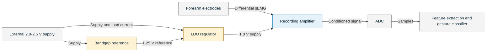

# System context: a wearable sEMG gesture interface

[Overview](../README.md) · [Task 1: PMU](task-1-pmu.md) · [Task 2: recording amplifier](task-2-semg.md)

## Application and design scope

The project implements the analogue circuits of a forearm-worn gesture interface. Surface electrodes detect muscle activity as the user moves their hand. A recording amplifier conditions the signal for digitisation, and a processor classifies the resulting activity pattern. A possible application is hand control of an AR/VR interface.

This application has published hardware examples. Wei, Chen and Gu demonstrate multichannel EMG sensing with on-chip gesture and activity classification for AR/VR. Benatti et al. demonstrate embedded learning and classification of EMG gestures on a low-power processing platform. These systems motivate the application; their classifiers and communication circuits are outside this project. [VLSI 2023 paper](https://users.eecs.northwestern.edu/~jgu/nu-vlsi/Human_Activity_Sense_VLSI2023.pdf), [TBioCAS 2019 paper](https://doi.org/10.1109/TBCAS.2019.2914476).

Students design one recording channel and its supporting bandgap reference (BGR) and low-dropout regulator (LDO). A practical gesture interface can use several electrode channels to observe different muscle groups. The single-channel design is a building block; it does not by itself establish a gesture-recognition accuracy.

## Signal and power paths

The BGR provides a voltage reference; the LDO supplies load current. The diagram shows a conventional ADC-based signal path for this project. Published systems may use other partitions: the VLSI example combines mixed-signal feature extraction with its classifier. ADC and processor supplies are omitted because those blocks are outside the circuit-design scope.

### Electrode interface

Wet Ag/AgCl electrodes provide the differential input. The amplifier must recover the changing muscle signal in the presence of electrode DC offset and common-mode interference. Yazicioglu et al. address these problems together using AC-coupled chopped instrumentation amplification; their readout supports EMG as well as EEG and ECG. [ISSCC 2006 paper](https://ieeexplore.ieee.org/document/1696039), [JSSC 2007 paper](https://doi.org/10.1109/JSSC.2007.894804).

The project's ±50 mV electrode-offset test makes DC rejection essential. Applying the nominal voltage gain of 100 directly to 50 mV would demand a 5 V output shift, beyond a 1.8 V supply. Reject this offset, for example with AC coupling or a DC-servo loop, while preserving the required signal band. This calculation explains the design constraint; it is not an additional specification.

High input impedance limits electrode loading. Differential acquisition rejects interference shared by the inputs, but the input stage must still accommodate their common-mode voltage. The specified CMRR test at 500 Hz is one measurement point; inspect the frequency response before drawing conclusions about interference at other frequencies.

### Recording amplifier

The channel targets 40 dB gain at 100 Hz, with nominal -3 dB cutoffs of 10 Hz and 1 kHz. The specified 2 mV peak-to-peak differential input then produces approximately 200 mV peak-to-peak output at 100 Hz. Set the output bias so that this signal fits within the available swing and the intended ADC input range. A fully differential implementation also needs suitable output common-mode control.

The lower cutoff rejects DC and attenuates slow changes; the upper cutoff limits out-of-band noise and signal content. The 1 kHz cutoff alone does not define an anti-alias filter: a complete acquisition system would also specify sampling rate and stop-band attenuation. Those choices are outside the current amplifier requirements.

Input-referred noise must remain below 5 µV RMS over 10-1000 Hz while total channel current stays at or below 20 µA. The current includes local bias and common-mode circuits, giving a maximum quiescent power of 36 µW at 1.8 V. These limits connect transistor sizing and bias current to usable signal quality.

Yang et al. provide a useful circuit example: a capacitively coupled chopper amplifier with programmable gain, filtering and a DC-servo loop. Their impedance-boosting circuit addresses input loading, and the paper includes human EMG recordings during arm extension. The design illustrates the interaction between offset rejection, bandwidth and impedance; its extra loops are optional techniques here. [CICC 2015 paper](https://coefs.charlotte.edu/jhollem3/files/2020/07/yang_bioamp_cicc2015.pdf).

### Bandgap reference and LDO

The BGR combines voltage or current components with opposing temperature coefficients to establish the nominal 1.25 V reference. Verify its startup, loading and maximum-to-minimum variation below 2 mV over 0-75 °C. Reference noise also matters: van Staveren et al. analyse the relationship between BGR noise and current consumption, showing why temperature stability is only one part of reference design. [TCAS-I paper](https://web.mit.edu/magic/Public/papers/00488808.pdf).

The LDO compares a fraction of its output with the BGR reference and adjusts the pass-transistor current. For the illustrated divider, with R1 above the feedback node and R2 below it, the ideal relationship is:

$$
V_{OUT} \approx V_{REF}\left(1+\frac{R_1}{R_2}\right),
\qquad \frac{R_1}{R_2}=\frac{1.8}{1.25}-1=0.44.
$$

Finite amplifier gain, loading and device non-idealities cause departures from this relationship. A larger pass transistor can reduce dropout, but its gate capacitance increases the amplifier's drive and compensation requirements. Rincón-Mora and Allen discuss this connection between load capability, transient response and quiescent current. [JSSC LDO paper](https://rincon-mora.gatech.edu/publicat/jrnls/jssc98_lv_ldo.pdf).

At the minimum 2.0 V input, only 200 mV separates the supply from the required 1.8 V output. Check operation near this limit at the required load. The 20 mA LDO rating is supply capacity for a larger analogue system, rather than the consumption of the single ≤ 20 µA recording channel. Use a separate load in the LDO testbench to exercise that capacity.

A straightforward supply arrangement powers the BGR and LDO error amplifier from the unregulated input. This allows them to start before the regulated rail exists. Other arrangements require a startup path that resolves this dependency. The 1.25 V BGR output does not automatically set the recording amplifier's output common-mode voltage; choose that bias for signal swing and the downstream interface.

## Integration checks

Reference disturbances can pass through the LDO's reference-to-output transfer function. Within the regulation bandwidth, its ideal low-frequency gain is approximately 1.8/1.25 = 1.44. A well-rejected disturbance on the LDO supply can therefore still matter if it reaches the reference input. Simulating the complete PMU with the actual BGR captures paths that an ideal reference source omits.

Keep each noise and rejection measurement tied to its definition. The LDO's output-noise limit covers 0.1-100 Hz; the amplifier's input-noise limit covers 10-1000 Hz. The PMU PSRR target is at 100 kHz, while the recording-amplifier PSRR target is at 500 Hz. These values cannot be combined into a single system result without the relevant transfer functions and common measurement conditions.

The existing [PMU](task-1-pmu.md#specifications) and [recording-amplifier](task-2-semg.md#specifications) tables define the design targets. The papers below provide application and circuit context, not extra numerical requirements.

## Selected IEEE papers

| Venue | Paper | Useful reading and limits |
| --- | --- | --- |
| ISSCC 2006 | R. F. Yazicioglu, P. Merken, R. Puers and C. Van Hoof, [*A 60 µW 60 nV/√Hz Readout Front-End for Portable Biopotential Acquisition Systems*](https://ieeexplore.ieee.org/document/1696039). | An EMG-capable readout addressing electrode offsets and common-mode rejection. The conference report of the work expanded in the JSSC paper below. [Institutional abstract](https://researchportal.rma.ac.be/en/publications/a-60%CE%BCw-60-nvhz-readout-front-end-for-portable-biopotential-acquis/). |
| JSSC 2007 | R. F. Yazicioglu, P. Merken, R. Puers and C. Van Hoof, [*A 60 µW 60 nV/√Hz Readout Front-End for Portable Biopotential Acquisition Systems*](https://doi.org/10.1109/JSSC.2007.894804), 42(5), 1100-1110. | Explains AC coupling, current-feedback amplification and chopping. Its 0.5 µm implementation consumes 20 µA at 3 V; it is not a verified 1.8 V GPDK180 solution. |
| VLSI Technology and Circuits 2023 | Y. Wei, X. Chen and J. Gu, [*Human Activity Recognition SoC for AR/VR with Integrated Neural Sensing, AI Classifier and Chained Infrared Communication for Multi-chip Collaboration*](https://doi.org/10.23919/VLSITechnologyandCir57934.2023.10185392). | Direct EMG-to-gesture context using six sensing channels per SoC. Its 65 nm implementation includes feature extraction, classification and communication beyond the project scope. [Author paper](https://users.eecs.northwestern.edu/~jgu/nu-vlsi/Human_Activity_Sense_VLSI2023.pdf). |
| CICC 2015 | T. Yang, J. Lu, M. S. Jahan, K. Griffin, J. Langford and J. Holleman, [*A Configurable 5.9 µW Analog Front-End for Biosignal Acquisition*](https://doi.org/10.1109/CICC.2015.7338491). | Gain, bandwidth, DC-servo and input-impedance design, with measured EMG. The 0.13 µm, 1.2 V implementation reports noise in configurations that differ from the project's integration band. |
| TCAS-I 1996 | A. van Staveren, C. J. M. Verhoeven and A. H. M. van Roermund, [*The Design of Low-Noise Bandgap References*](https://web.mit.edu/magic/Public/papers/00488808.pdf), 43(4), 290-300. | Reference-noise analysis under a current budget. Its bipolar circuit is a design-principle example, not a GPDK180 implementation. |
| JSSC 1998 | G. A. Rincón-Mora and P. E. Allen, [*A Low-Voltage, Low Quiescent Current, Low Drop-Out Regulator*](https://doi.org/10.1109/4.654935), 33(1), 36-44. | Pass-device loading, amplifier drive and load-dependent stability. Adapt the reasoning to the project's supply, devices and load rather than copying its circuit dimensions. |
| TBioCAS 2019 | S. Benatti, F. Montagna, V. Kartsch, A. Rahimi, D. Rossi and L. Benini, [*Online Learning and Classification of EMG-Based Gestures on a Parallel Ultra-Low Power Platform Using Hyperdimensional Computing*](https://doi.org/10.1109/TBCAS.2019.2914476), 13(3), 516-528. | Embedded EMG learning and gesture classification. Provides downstream system context; its classification results are not amplifier specifications. |

[Overview](../README.md) · [Task 1](task-1-pmu.md) · [Task 2](task-2-semg.md)
