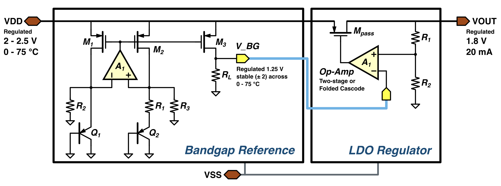
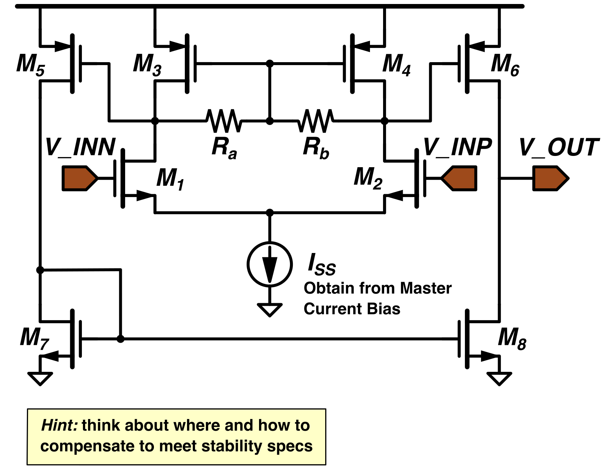

# Task 1: Power management unit

[Overview](../README.md) · [System context and papers](system-context.md) · [Task 2](task-2-semg.md)

## Circuit

Design a GPDK180 bandgap reference (BGR) and low-dropout regulator (LDO) in Cadence Virtuoso. Connect the BGR's nominal 1.25 V output to the LDO reference input. The complete PMU must supply 1.8 V at load currents up to 20 mA.

*Example PMU. Supply the power path from the unregulated input and verify startup with the actual amplifier supplies. The figure's "±2" annotation is incorrect; use the BGR maximum-to-minimum variation below.*

## Specifications

| Block | Parameter | Target |
| --- | --- | --- |
| LDO | Input voltage | 2.0-2.5 V |
| LDO | Output voltage | 1.8 V |
| LDO | Maximum output current | 20 mA |
| LDO | Quiescent current | < 100 µA |
| LDO | Dropout voltage | < 200 mV |
| LDO | PSRR | ≥ 40 dB at 100 kHz |
| LDO | Integrated output noise | < 100 µV RMS over 0.1-100 Hz |
| LDO | Loop phase margin | ≥ 60° |
| BGR | Supply voltage | 2.5 V maximum |
| BGR | Output voltage | Nominally 1.25 V |
| BGR | Temperature variation | Maximum minus minimum reference voltage < 2 mV over 0-75 °C |
| BGR | PSRR | ≥ 40 dB at 100 kHz |
| BGR | Quiescent current | < 100 µA |

Each block's quiescent-current budget includes its operational amplifier, bias and startup circuits, but excludes external load current. Identify shared bias currents and count them once in the total PMU current.

The BGR temperature limit is the full maximum-to-minimum variation, not ±2 mV. State the supply and reference load used to measure it.

## Operational amplifiers

Choose a suitable amplifier for each block; the BGR and LDO may use different topologies. Derive device sizes and bias currents from the connected circuit's requirements.

*Example topology. Set device dimensions, bias generation and compensation for the actual load and feedback loop.*

| Property | Design and verification requirement |
| --- | --- |
| Implementation | Use GPDK180 devices; justify each topology and any differences between the two amplifiers. |
| Supply and startup | Use the block's actual supply arrangement; verify startup without an already-established regulated output. |
| Input common-mode range | Cover the BGR or LDO sensing-node voltages over the operating range. |
| Output swing and drive | Drive the connected load, including the LDO pass-transistor gate, over the operating range. |
| DC gain | Measure open-loop gain at the relevant bias point and relate it to reference accuracy and output regulation. |
| Bandwidth and slew rate | Measure unity-gain bandwidth and slew rate with the actual load; justify them using startup and transient results. |
| Stability | Check the actual feedback loops: LDO phase margin ≥ 60°; record BGR loop-stability results. |
| Current, noise and PSRR | Include amplifier and bias contributions in the complete block's results and current budget. |

There are no separate numerical op-amp gain, bandwidth or slew-rate targets. Choose values that allow the complete PMU to meet its specifications.

## BGR and LDO design

For the BGR, calculate the PTAT and CTAT contributions, including bipolar-device area ratios and resistor values. Check current matching and finite-output-resistance effects such as channel-length modulation. Implement a startup circuit and verify the reference with its actual load.

For the LDO, size the pass transistor and feedback divider for output voltage, load current and dropout. Select the output capacitor and equivalent series resistance (ESR), then design compensation and check line regulation, load regulation and load transients.

Connect both blocks and repeat the checks on the complete PMU. Reference loading and shared biasing must remain valid after integration.

## Simulation checks

Record supply voltage, load current, output capacitance and ESR, reference loading, process corner and temperature for every result. For amplifier measurements, also record input common-mode voltage and output operating point.

| Analysis | Check |
| --- | --- |
| DC operating point and sweeps | Device regions, bias currents, line/load regulation and dropout. |
| Temperature sweep | BGR maximum-to-minimum reference variation over 0-75 °C. |
| Transient | BGR, LDO and integrated PMU startup; supply and load steps with amplitudes and edge times stated. |
| Loop stability | LDO phase margin and BGR stability with the connected loads. |
| Supply rejection | PSRR frequency response for each block, including the value at 100 kHz. |
| Noise | LDO output noise integrated over 0.1-100 Hz, including amplifier contributions. |
| Current | Complete-block quiescent currents and shared-current accounting. |
| Corners and integration | TT, FF and SS, temperature sweeps, and complete PMU operation; compare results with every target. |

The brief does not set an LDO output-voltage tolerance or dropout measurement criterion. It also leaves output capacitance, ESR, reference loading and transient-step conditions unspecified. State and justify these test conditions rather than adding numerical requirements.

## Cadence interface

Keep the complete circuit accessible through this interface for the common testbench.

| Item | Required value |
| --- | --- |
| Library | `cw_submission` |
| Top-level cell | `pmu_top` |
| Views | `schematic` and `symbol` |
| Netlist terminal order | `VDD VSS VOUT` |
| Symbol pin placement | `VDD` left; `VSS` bottom; `VOUT` right |

| Terminal | Cadence direction | Function |
| --- | --- | --- |
| `VDD` | `inputOutput` | External unregulated supply |
| `VSS` | `inputOutput` | Ground and supply return |
| `VOUT` | `output` | Regulated PMU output |

Terminal names are case-sensitive. Internal cell names and hierarchy are flexible; include all dependencies needed to simulate the complete circuit.

## Reading

- B. Razavi, *The Design of an LDO Regulator*, IEEE Solid-State Circuits Magazine, 2022. [DOI](https://doi.org/10.1109/MSSC.2022.3167308) · [PDF](../resources/articles/%5BRazavi%5D_The_Design_of_An_LDO_Regulator.pdf).
- [Bandgap-reference design](../resources/articles/%5BRazavi%5D_The_Design_of_A_Bandgap_Reference.pdf).
- [Single-stage op-amp design](../resources/articles/%5BRazavi%5D_One_Stage_OpAmp.pdf).

[Overview](../README.md) · [Task 2](task-2-semg.md)
