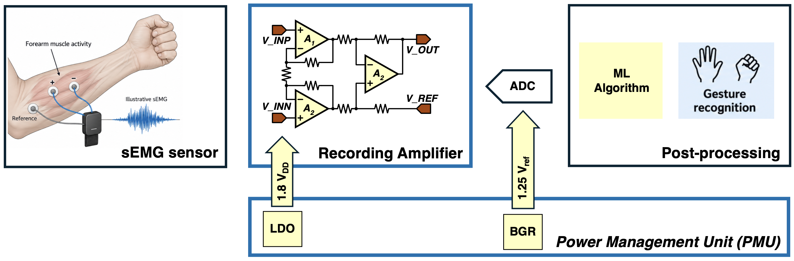
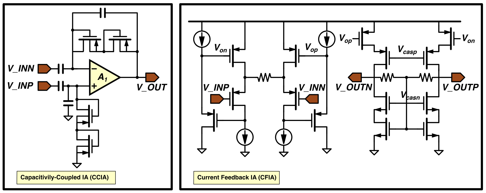

# Chapter 2: Task 2 - Surface EMG Recording Amplifier

[Coursework overview](../README.md) · [Previous: Task 1](task-1-pmu.md)

## 2.1 Objective and application

Design a transistor-level recording amplifier for surface electromyography (sEMG) acquisition from wet Ag/AgCl forearm electrodes. The amplifier conditions small differential muscle signals for digitisation and subsequent gesture recognition.

The analogue front end receives a 1.8 V supply from an LDO; a bandgap reference supports the power and reference-voltage functions. The ADC and machine-learning stages provide application context. This task concerns the recording amplifier and its verification.

*Figure 3. Recording-amplifier application. The three-op-amp circuit is one illustrative topology, not a required implementation. The figure repeats the A2 label; identify the three amplifiers separately in your design. Its amplifier output-bias reference and ADC reference are distinct functions.*

## 2.2 Required specifications

The following values follow Table 6 of the source brief. In particular, the nominal passband is **10 Hz to 1 kHz**, and the channel-current limit is **20 µA**.

| Parameter | Target |
| --- | --- |
| Supply voltage | 1.8 V |
| Channel configuration | Differential input; single-ended or fully differential output |
| Voltage gain | 40 dB; gain error < 0.5 dB at 100 Hz |
| Lower -3 dB cutoff | 10 ± 2 Hz |
| Upper -3 dB cutoff | 1 ± 0.2 kHz |
| Input-referred noise | < 5 µV RMS integrated over 10-1000 Hz |
| Linearity | THD < 0.5% at 100 Hz with a 2 mV peak-to-peak differential input |
| Differential electrode DC offset | Tolerate -50 mV to +50 mV after settling, without saturation, while retaining the specified gain and THD |
| CMRR | > 60 dB at 500 Hz in nominal matched simulation |
| PSRR | > 40 dB at 500 Hz |
| Input impedance | ≥ 10 MΩ at 500 Hz |
| Channel current | ≤ 20 µA total quiescent current, including local bias and common-mode circuitry; excludes the LDO and BGR |
| Stability | Phase margin ≥ 45° if feedback is used |
| Load evaluation | Assess operation with 1-5 pF capacitive loads |
| Area | Report total capacitance and estimated device/passive area; no layout or fabricated-area requirement |

Electrode DC offset is an external differential input offset, not the OTA's intrinsic input offset. At 1.8 V, the 20 µA channel budget corresponds to at most 36 µW quiescent power. A 40 dB gain is a voltage gain of 100, so the specified 2 mV peak-to-peak input gives approximately 200 mV peak-to-peak output at 100 Hz.

The earlier exploratory targets of a 500 Hz upper cutoff, 100 µA channel current and 60° phase margin are superseded by the table above.

## 2.3 Architecture selection

Choose an architecture based on noise, power, headroom, input impedance, offset handling, bandwidth and stability. Assessment concerns the engineering justification and demonstrated performance, rather than selection of a particular topology.

| Architecture | Reference | Design questions |
| --- | --- | --- |
| Current-feedback instrumentation amplifier (CFIA) | Yazicioglu et al. [2] | How do current feedback, input common mode and offset handling affect gain, noise and power? |
| Capacitively coupled instrumentation amplifier (CCIA) | Fan et al. [3] | How are gain and the lower cutoff set, and how do input capacitance, DC feedback and optional chopping affect performance? |
| Three-op-amp instrumentation amplifier | Analog Devices MT-063 [4] | Can the architecture meet the 1.8 V headroom and 20 µA total-current limits while rejecting electrode DC offsets? |
| Inverter-based amplifier | Vieira et al. [5] | How are bias, common-mode behaviour, gain and bandwidth controlled over process and supply variations? |

*Figure 4. Example CCIA and CFIA structures. Adapt the circuit to GPDK180, implement required bias and feedback functions, and verify the complete recording channel. The examples are not complete verified solutions.*

Explain how the design establishes its DC operating point, rejects electrode offsets, sets both cutoff frequencies and accommodates its output load. Include common-mode feedback when required by the selected output configuration. Chopping is a possible design technique, not a compulsory feature.

## 2.4 Verification and evidence

State the supply, input common-mode voltage, output operating point, electrode offset, input stimulus, output load, process corner and temperature for each simulation. Define any supply-variation sweep and other test conditions not numerically fixed by the brief.

- [ ] **DC operation:** bias currents, operating regions, input common mode and available output swing.
- [ ] **Frequency response:** gain at 100 Hz and both -3 dB cutoff frequencies, with the reference gain stated.
- [ ] **Noise:** input-referred spectrum and integrated RMS noise over 10-1000 Hz, including bias and feedback-network contributions.
- [ ] **Linearity:** THD for a 100 Hz, 2 mV peak-to-peak differential input, after startup and settling.
- [ ] **Electrode offset:** demonstrate the required -50 mV to +50 mV tolerance and retain the gain and THD limits after settling.
- [ ] **Interference rejection:** CMRR and PSRR at 500 Hz, with stimulus definitions and gain ratios documented.
- [ ] **Input impedance:** measurement at 500 Hz, identifying whether the reported value is differential or per input.
- [ ] **Current:** total channel quiescent current including bias and common-mode circuitry.
- [ ] **Stability and load:** loop phase margin where applicable and operation with 1-5 pF loads.
- [ ] **Robustness:** TT, FF and SS process corners, supply variations and load-capacitance conditions, with results compared against targets.
- [ ] **Area estimate:** total capacitance and estimated device/passive area, with the estimation method explained.

Include a target-versus-result table and discuss trade-offs and limitations. For clarity, distinguish the amplifier's own noise from any noise included in the electrode-source model. The brief does not specify whether the input-impedance limit is per input or differential, so state the convention explicitly and preferably report both.

## 2.5 Suggested collaboration

| Responsibility | Suggested lead activities |
| --- | --- |
| Input stage and noise | Differential input stage, biasing, electrode-offset handling, gain/transconductance calculations, noise and CMRR simulations |
| Output stage and stability | Gain/output stage where applicable, frequency shaping, compensation, 1 kHz upper cutoff, stability and capacitive-load evaluation |
| Shared | Architecture selection, initial sizing, schematic reviews, complete verification, trade-off analysis and reporting |

Adapt this division to the chosen architecture; a single-stage solution need not introduce an unnecessary output stage. Both contributors should understand the complete signal path and cross-check each other's results.

## 2.6 Report and deliverables

Provide a report section of at most 8 pages. **No design files are required for Task 2; evaluation is based on the report.** The PMU symbol interface in Task 1 does not apply to this amplifier.

The report should contain:

1. The selected architecture and intended circuit operation.
2. Analytical calculations, transistor sizing and component/bias choices.
3. Schematics and simulation evidence for each performance requirement.
4. Noise, stability, linearity and corner analysis.
5. A final specification comparison, including limitations and optimisation decisions.
6. Each contributor's technical work and critical reflection on the design process.

Present plots with readable axes, units, conditions and markers. Explain results rather than relying on screenshots alone.

## 2.7 References and supporting reading

1. X. Tang, Y. Liu, C. Lv and D. Sun, *Hand Motion Classification Using a Multi-Channel Surface Electromyography Sensor*, Sensors, 12(2), 1130-1147, 2012. [DOI](https://doi.org/10.3390/s120201130).
2. R. F. Yazicioglu, P. Merken, R. Puers and C. Van Hoof, *A 60 µW 60 nV/√Hz Readout Front-End for Portable Biopotential Acquisition Systems*, JSSC, 42(5), 1100-1110, 2007. [DOI](https://doi.org/10.1109/JSSC.2007.894804).
3. Q. Fan, F. Sebastiano, J. H. Huijsing and K. A. A. Makinwa, *A 1.8 µW 60 nV/√Hz Capacitively-Coupled Chopper Instrumentation Amplifier in 65 nm CMOS for Wireless Sensor Nodes*, JSSC, 46(7), 1534-1543, 2011. [DOI](https://doi.org/10.1109/JSSC.2011.2143610).
4. Analog Devices, *MT-063: Basic Three Op Amp In-Amp Configuration*. [Tutorial](https://www.analog.com/media/en/training-seminars/tutorials/MT-063.pdf). The tutorial title has been corrected from the source brief's reference list.
5. R. Vieira et al., *A Tunable Gain and Bandwidth Low-Noise Amplifier with 1.44 NEF for EMG and EOG Biopotential Signal*, Electronics, 12(12), 2592, 2023. [DOI](https://doi.org/10.3390/electronics12122592).

Additional repository reading: [Harrison and Charles baseline recording amplifier](../resources/%5BRecording_Amp%5D_Baseline_Harrison_and_Charles.pdf) and [Denison et al. chopping example](../resources/%5BRecording_Amp%5D_Chopping_Denison_et_al.pdf). These are supporting examples, not extra required implementations.

[Back to overview](../README.md) · [Return to Task 1](task-1-pmu.md)
